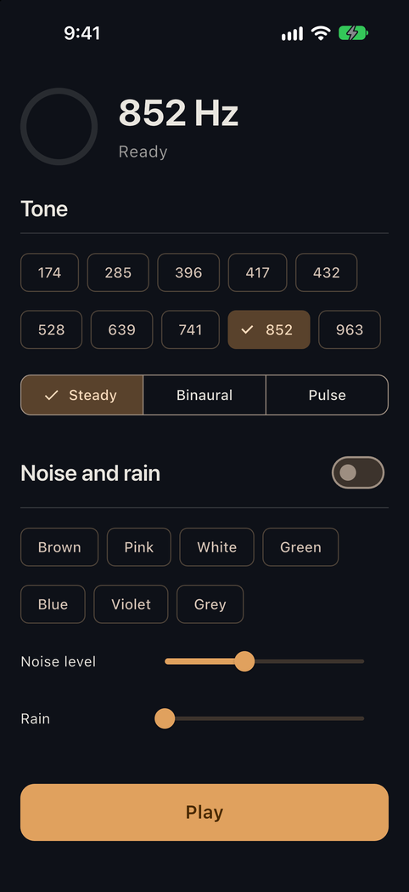

# hush_audio

[](https://github.com/abiodunosagie/hush_audio/actions/workflows/ci.yml)

A calm and sleep sound engine for Flutter, powered by Rust. It plays pure tones, binaural and isochronic beats, seven colours of noise and five procedural nature sounds, all synthesized live on the device's audio thread. Nothing is a recording, so nothing loops, and the package adds about 300 KB to an app.



The engine is [hush-core](https://github.com/abiodunosagie/hush-core), written in Rust. This package compiles it for the platform being built, through Flutter's native-assets build hooks, and wraps it in a typed Dart API. There is no method channel, no generated glue and no platform code to maintain: Dart calls the Rust library directly through `dart:ffi`.

| Platform | Audio output | Minimum |
|---|---|---|
| iOS | Core Audio (via cpal) | iOS 15 |
| Android | AAudio | API 26 (Android 8.0) |
| macOS | Core Audio (via cpal) | macOS 12 |

## Install

You need Flutter 3.47 or later and [rustup](https://rustup.rs). The first build installs the pinned Rust toolchain and compiles the engine; later builds reuse it.

```yaml
dependencies:
  hush_audio:
    git: https://github.com/abiodunosagie/hush_audio
```

On Android, set `minSdk = 26` in `android/app/build.gradle.kts`. On iOS, configure the audio session so the ring switch does not mute playback, for example with [`audio_session`](https://pub.dev/packages/audio_session):

```dart
final session = await AudioSession.instance;
await session.configure(const AudioSessionConfiguration.music());
```

## Use

```dart
import 'package:hush_audio/hush_audio.dart';

final engine = HushEngine()
  ..toneFrequency = 852
  ..toneMode = ToneMode.binaural   // headphones; ToneMode.isochronic works on speakers
  ..beatHz = 6
  ..noiseEnabled = true
  ..noiseColor = NoiseColor.brown
  ..setAmbient(Ambient.rain, 0.5);

engine.start();                                    // opens the speaker, still silent
engine.play(fadeIn: const Duration(seconds: 2));   // fades in

// Anything can change while it plays; every change is smoothed, so sliders never click.
engine.toneFrequency = 528;

// A sleep timer: fade over ten minutes, then close the output once it is silent.
engine.fadeOut(const Duration(minutes: 10));
if (engine.masterGain == 0) engine.stop();

engine.dispose();
```

`masterGain` reports the level the engine last rendered, so a UI can draw fades and know when a fade-out has finished. The example app polls it to fill a ring.

### Controls

| Member | Range | Notes |
|---|---|---|
| `toneEnabled`, `toneFrequency`, `toneLevel` | 20 to 2000 Hz, 0 to 1 | Defaults: on, 852 Hz, 0.6. |
| `toneMode` | `steady`, `binaural`, `isochronic` | Binaural needs headphones. |
| `beatHz` | 0.5 to 40 | Pulse rate for binaural and isochronic. |
| `noiseEnabled`, `noiseColor`, `noiseLevel` | 7 colours, 0 to 1 | Colours are level-matched. |
| `setAmbient(kind, level)` | rain, ocean, wind, fire, stream; 0 to 1 | Any number at once. |
| `swell`, `spatial` | on or off | Breathing swell; side-to-side movement of noise and nature. |
| `play`, `fadeOut` | any duration | From a 10 ms click-free start to a 10 minute sleep fade. |

Out-of-range values are clamped and non-finite values are ignored, so a bad slider value can never break the audio.

### Render without a speaker

`HushRenderer` runs the same engine into memory. It is what the tests use, and it works for previews or exporting audio:

```dart
final renderer = HushRenderer(engine, sampleRate: 48000);
final Float32List stereo = renderer.render(48000);   // one second, interleaved left/right
renderer.dispose();
```

## How it works

```
Dart  HushEngine ──dart:ffi──▶ Rust C ABI ──▶ hush-core Synth ──▶ cpal / AAudio ──▶ speaker
                  @Native         rust/src/lib.rs   (no allocation      rust/src/player.rs
                  lib/src/bindings.dart              on the audio thread)
```

- **Native assets, not a plugin channel.** `hook/build.dart` runs on every `flutter build` and uses [`native_toolchain_rust`](https://pub.dev/packages/native_toolchain_rust) to compile `rust/` for the exact target being built, from Android ARM and x86 to iOS device and simulator to universal macOS. Flutter then bundles the library. `lib/src/bindings.dart` declares each Rust function with `@Native`, so calls go straight to native code with no `DynamicLibrary.open`, no codegen and no message passing.
- **A small C ABI with three handles.**
  - **Params** holds the controls. It is a reference-counted bundle of atomics, so the UI thread writes and the audio thread reads without locks. A player keeps its own reference, so freeing Dart's handle never pulls the controls out from under live audio.
  - **Player** owns the device stream.
  - **Offline** renders into a caller's buffer.

  Every exported function accepts a null handle and does nothing, so a Dart mistake gives silence rather than a crash. The Dart objects attach `NativeFinalizer`s, so params and renderers are freed even if `dispose` is forgotten.
- **Real-time safe.** The audio callback only calls hush-core's `render_interleaved`, which never allocates, locks or blocks; a hush-core test proves it with a counting allocator. On Core Audio the scratch buffer is sized once, before the stream starts.
- **AAudio on Android, deliberately.** cpal's Android backend asks the JVM for audio settings through a global Android context. That context only exists when Rust runs inside an Android activity, not when a library is loaded by `dart:ffi`, so opening a stream would abort the app. The Android player therefore talks to AAudio directly through the `ndk` crate: stereo float at 48 kHz, low-latency mode, and the stream is checked to be in that shape before it starts.
- **Reproducible builds.** `rust/rust-toolchain.toml` pins Rust 1.99.0 and its targets, and `rust/Cargo.lock` pins every dependency, including hush-core at a fixed commit.

### Threading

Create, `start`, `stop` and `dispose` an engine on one isolate, normally the main one: the Core Audio stream must be released on the thread that opened it. Setters are cheap leaf calls, safe to drive from a slider.

## Tests

```bash
dart test                 # the Dart API against the real Rust engine, rendered offline
cd rust && cargo test     # the C ABI: null handles, lifetimes, enum validation
```

The Dart tests build the native library through the same hook an app uses, then check:

- silence until `play`, then the default tone measured at 852 Hz;
- the frequency control changes the measured pitch;
- binaural mode puts frequencies 10 Hz apart in the two ears;
- a fade-out ends in exact silence;
- noise and rain sound with the tone off, and stay finite and within full scale;
- out-of-range and NaN values are clamped or ignored;
- a disposed engine refuses further use.

No test opens an audio device. CI runs Rust formatting, Clippy for the host and Android, the Rust and Dart tests, analysis, an iOS simulator build on macOS, and an Android APK build on Linux.

## Example app

`example/` is a small Flutter app with a Cubit (`flutter_bloc`): presets, tone modes, beat rate, noise colours and a rain slider, with a level ring that follows fades.

```bash
cd example
flutter run
```

## Project layout

```
hook/build.dart          compiles rust/ for the target platform (native assets)
lib/hush_audio.dart      public API: HushEngine, HushRenderer, enums
lib/src/bindings.dart    @Native declarations of the Rust functions
rust/src/lib.rs          C ABI over hush-core: params, offline renderer, player
rust/src/player.rs       device output: cpal on Apple platforms, AAudio on Android
rust/rust-toolchain.toml pinned toolchain and targets
test/                    Dart tests against the real engine
example/                 Flutter demo app
```

## Not included

Background playback configuration, a web build (hush-core has its own WebAssembly demo) and Windows or Linux targets. The tone and preset names follow the traditional Solfeggio and brainwave labels; this is not a medical device and makes no health claims.

## License

MIT. See [LICENSE](LICENSE).

## Author

Abiodun Osagie, mobile, front-end and full-stack developer.
[Portfolio](https://smithportfolio.smitho.workers.dev) · [GitHub](https://github.com/abiodunosagie) · [LinkedIn](https://linkedin.com/in/osagieabiodun)
